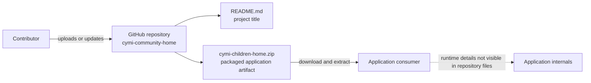

# Architecture overview

## Repository-level view

The repository currently publishes the CYMI Children Home application as a ZIP archive. The archive is the only application artifact tracked at the repository root; the README contains only the project title. Because the archive contents are not represented as browsable source files here, this diagram describes the repository and artifact boundary rather than the application's internal runtime architecture.

## Repository components

- **`README.md`** — identifies the project as `cymi-community-home`.
- **`cymi-children-home.zip`** — packaged application archive (approximately 11.3 MB).

The repository does not currently expose source directories, build manifests, deployment configuration, or application documentation outside the archive. Consequently, the application's framework, services, data stores, and runtime request flow cannot be established from the tracked repository files alone.
